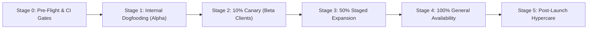

# Staged Rollout and Launch Plan

## 1. Release Strategy Overview
To ensure zero unexpected downtime, protect financial data integrity, and guarantee reliable billing transitions, Brightloop employs a multi-gate staged rollout procedure.

---

## 2. Rollout Phases

### Stage 0: Pre-Flight Verification & CI Gates
- All 5 test phases certified green (unit, integration, and E2E suites).
- OWASP security headers and rate-limiting validated.
- Database migration applied and verified on empty & staging copies.
- Automated backup-restore drill completed with measured RTO < 30s.

### Stage 1: Internal Dogfooding (Internal Staff Only - Day 1 to 3)
- Target: Brightloop internal sales, finance, and executive accounts.
- Activity: Create sample enterprise catalogues, test quotation builder, generate real internal test subscriptions.
- Success Criteria: Zero unhandled 500 errors, quotation to subscription conversion flawless, PDF invoice renders correctly.

### Stage 2: 10% Canary Rollout (Friendly Beta Customers - Day 4 to 7)
- Target: 10% of active customer base (low-volume tier).
- Traffic routing: Managed via load balancer or API Gateway weighted routing.
- Worker: Run 1 background worker replica with scheduled sweeps enabled.
- Success Criteria:
  - API P95 latency strictly below 2 seconds.
  - HTTP 5xx error rate < 0.05%.
  - Zero duplicate occurrences or invoices.

### Stage 3: 50% Staged Expansion (Day 8 to 11)
- Target: 50% customer traffic across all billing intervals (monthly, yearly).
- Activity: Monitor database connection pool saturation, payment allocation concurrency, and queue depths.
- Success Criteria:
  - Reconciliation equation holds: `Total Invoiced = Collected + Owed`.
  - Zero poison queue occurrences.

### Stage 4: 100% General Availability (GA - Day 12+)
- Route 100% of customer portal and staff traffic to production cluster.
- Enable high-volume automated billing workers with redundant failover.
- Publish public status page and documentation.

### Stage 5: Post-Launch Hypercare (Day 12 to 26)
- 24/7 on-call coverage for billing runs and payment processing.
- Daily reconciliation audit review between finance controller and lead engineer.
- Immediate SLA response for any billing-related inquiries.

---

## 3. Automated Telemetry & Circuit Breaker Thresholds

The deployment system monitors the following metrics in real-time. Exceeding any threshold pauses traffic progression or triggers automated rollback:

| Telemetry Metric | Warning Threshold | Automated Rollback Trigger |
|---|---|---|
| **API 5xx Error Rate** | > 0.5% over 5 mins | > 1.5% over 3 mins |
| **P95 Latency** | > 1500 ms | > 3000 ms over 5 mins |
| **Billing Run Failures** | > 1 failed occurrence | > 5 failed occurrences in single sweep |
| **Reconciliation Discrepancy** | Any non-zero difference | $\Delta \ne 0$ detected |
| **DB Connection Pool Saturation** | > 75% pool active | > 90% pool active |

---

## 4. Rollback & Emergency Abort Playbook

If a critical rollback trigger is met during any stage:

1. **Traffic Diversion**:
   - Revert load balancer routing to previous stable artifact or maintenance page.
2. **Halt Scheduled Billing Worker**:
   - Issue `SIGTERM` to worker replicas to pause new occurrence creation.
3. **Database Migration Policy**:
   - Follow forward-only migrations. If schema requires rollback, verify that no newly generated customer data will be dropped before applying inverse migration.
4. **Data Consistency Audit**:
   - Execute `npm run backup-restore` to confirm data integrity and verify financial reconciliations.

